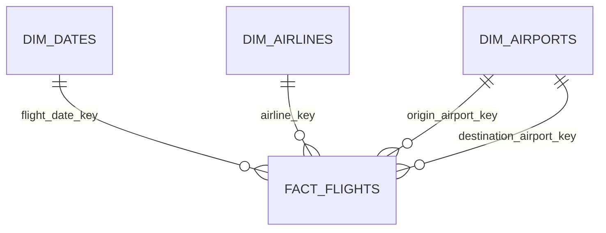

# Phase 1.4 — Core 数据仓库

Phase 1.4 已实现并验证一个最小 Kimball 星型模型。Core 面向可复用的明细分析，不在本层定义 KPI 分母或业务聚合。

## 架构与 schema

```text
ingestion.source_file / ingestion.ingestion_batch
                         │
raw.bts_on_time_performance                  （table，原始 BTS 字段与 lineage）
                         │
analytics_staging.stg_bts_flights            （view，一条源记录一行）
                         │
              ┌──────────┼───────────┐
              │          │           │
       dim_airlines dim_airports fact_flights
              └──────────┼───────────┘
                         │
                  analytics_marts             （Core tables）

dim_dates 独立生成固定日历，并由 fact_flights 引用。
```



dbt 使用默认 `<target_schema>_<custom_schema>` 规则。当前 target schema 是 `analytics`；staging 模型显式使用 custom schema `staging`，`models/marts/` 配置为 table 和 custom schema `marts`。项目没有覆盖 `generate_schema_name`。

| 层 | PostgreSQL schema | 物化 |
|---|---|---|
| 摄取审计 | `ingestion` | table，由 Python/SQL 摄取拥有 |
| Raw | `raw` | table，由 Python/SQL 摄取拥有 |
| Staging | `analytics_staging` | view |
| Core | `analytics_marts` | table |

## Core 模型与粒度

| 模型 | 精确粒度 | 逻辑主键 |
|---|---|---|
| `dim_dates` | 一个自然日；固定覆盖 2024-01-01 至 2025-12-31 | `date_key`（YYYYMMDD integer） |
| `dim_airlines` | 一个 `dot_airline_id` | `airline_key = generate_key(dot_airline_id)` |
| `dim_airports` | 一个 BTS `airport_sequence_id` 属性版本 | `airport_key = generate_key(airport_sequence_id)` |
| `fact_flights` | 一条 ingested BTS source record | staging 继承的 `flight_record_key` |

`flight_record_key` 由 `source_file_id` 和 `source_row_number` 生成，标识当前摄取 lineage 内的 CSV 记录。它不是现实世界唯一航班标识，且独立数据库重建后 `source_file_id` 的分配可能不同。航班日期、航司、航班号、机场和计划时间的组合也不得用于静默去重。

事实表保留 `source_file_id`、`source_row_number`、`batch_id`、`ingested_at`，并直接从 staging 一对一投影，不通过维度 join 生成事实行。维度外键为：

- `flight_date_key → dim_dates.date_key`
- `airline_key → dim_airlines.airline_key`
- `origin_airport_key → dim_airports.airport_key`
- `destination_airport_key → dim_airports.airport_key`

`dim_airports` 是 role-playing dimension；origin 和 destination 共用同一张表。`airport_id` 是跨时期的持久机场身份，`airport_sequence_id` 是 BTS 提供的时点属性版本，所以 `airport_id` 不要求唯一。`dim_airlines` 当前不实施 SCD Type 2。

## BTS 业务语义

- 取消、备降、gate-return 和疑似重复报告记录全部保留，事实表不聚合、不去重。
- signed delay 保留提前运行的负数；nonnegative delay 将提前运行表示为零，两个指标不能混用。
- 取消/备降记录的实际时间、arrival delay、cause delay 等字段可合法为空；Core 不把 NULL 转为零。
- HHMM 均为机场当地时间。`day_offset` 只表示原始值 `2400`，不能据此构造完整跨日或跨时区时间戳。
- 同一 DOT ID 或 airport sequence ID 出现多组属性时，测试失败；不得用 `MIN()`、`MAX()` 或任意 `DISTINCT ON` 掩盖冲突。
- State FIPS 保留为文本，防止 `01` 等前导零丢失。
- Raw 中可解析但为负数的 elapsed-time 值作为源异常原样保留到 Staging 和 Fact；对应三值质量标志为 `FALSE`，缺失为 `NULL`，有效非负值为 `TRUE`。KPI 必须只把标志为 `TRUE` 的值当作有效 duration。
- BTS reporting flight number 通常存在，但 2024-08 已确认一条源 CSV 空字段；Staging 和 Fact 保留其 `NULL`。精确例外测试使用 source 年月、CSV checksum、source row 和 raw 空字符串共同约束，任何新增、变化或消失都会失败。

## 数据质量策略

测试覆盖以下层次：

1. Raw 格式：日期、数值、布尔、HHMM、标识符和溢出风险。
2. Staging 业务规则：日期组成、signed/nonnegative delay、15 分钟标志、取消、备降、`flight_count`、2400 offset、raw/staging lineage 与等行数。
3. 维度：主键唯一/非空、日历完整性、航司/机场属性冲突、origin/destination 一致性、自然键覆盖和确定性 key。
4. 事实：主键和 lineage 唯一、staging/fact 双向覆盖与等行数、所有共享值的 `EXCEPT ALL` NULL-safe 保真、取消/备降计数、四个 relationship tests。

2024–2025 全量数据中已确认 7 个负 elapsed-time 源异常。例外测试使用 source 年月、CSV checksum、source row、字段名和原值共同识别；集合必须与已知清单完全一致，因此任何新增、消失或变化都会失败。numeric 测试仍严格检查格式、可解析性和类型范围，负 duration 的业务合法性由独立测试负责。

dbt 的 `unique`、`not_null`、`relationships` 是构建后查询，不会创建 PostgreSQL `PRIMARY KEY` 或 `FOREIGN KEY` constraint。Core 由 dbt 受控构建，当前以 data tests 强制逻辑契约。

## January 2024 验证基线

Phase 1.4 Step 6 的实际端到端结果：

| Relation | 实际行数 |
|---|---:|
| `raw.bts_on_time_performance` | 547,271 |
| `analytics_staging.stg_bts_flights` | 547,271 |
| `analytics_marts.fact_flights` | 547,271 |
| `analytics_marts.dim_dates` | 731 |
| `analytics_marts.dim_airlines` | 15 |
| `analytics_marts.dim_airports` | 334 |

事实表有 547,271 个不同 `flight_record_key` 和 547,271 个不同 `(source_file_id, source_row_number)`；四维 join 后仍为 547,271 行，未匹配行数为 0。取消记录为 20,389，备降记录为 1,512。

完整 `dbt build`：125 passed、0 warnings、0 errors、0 skipped。独立 `dbt test`：120 passed、0 warnings、0 errors、0 skipped。Python：13 passed、2 skipped；两个 integration tests 因未配置隔离的 `TEST_DATABASE_URL` 而按设计跳过。

## 本地复现

从仓库根目录执行：

```bash
source .venv/bin/activate
set -a
source .env
set +a

dbt debug --project-dir dbt --profiles-dir dbt
dbt parse --project-dir dbt --profiles-dir dbt
dbt compile --project-dir dbt --profiles-dir dbt
dbt ls --project-dir dbt --profiles-dir dbt
dbt build --project-dir dbt --profiles-dir dbt
dbt test --project-dir dbt --profiles-dir dbt
dbt docs generate --project-dir dbt --profiles-dir dbt
pytest
```

`dbt docs generate` 在 `dbt/target/` 生成 `manifest.json`、`catalog.json` 和 `index.html`。生成 artifacts 不等于已经启动或检查浏览器 UI。

集成测试必须使用独立测试数据库：

```bash
export TEST_DATABASE_URL='postgresql://.../flightops_test'
pytest tests/integration
```

不得将开发数据库作为集成测试替代品。

## 已知限制与延期项

- 日期维度仅覆盖到 2025-12-31；加载 2026 数据前必须显式扩展并更新日历测试。
- 机场没有时区、坐标或 NOAA station 映射；当前本地时间不能支持可靠 UTC 或跨午夜序列。
- 当前 January 2024 尚未出现一个 airport ID 的多个 sequence version，也未出现航司代码历史冲突；测试会在未来月份暴露这些情况。
- 事实表包含事后运行结果。未来 pre-departure ML feature model 必须使用预测时点 allowlist，防止 target leakage。
- Core 当前全量 table 重建。只有多月份构建时间超过可接受阈值后才评估 incremental。
- KPI 分母、取消/备降在具体指标中的处理方式尚未定义，不属于 Core 层。

下一步建议先独立评审 KPI 口径和面向 BI 的 mart 设计，再开始 Tableau；本文件不授权或实现下一阶段。
